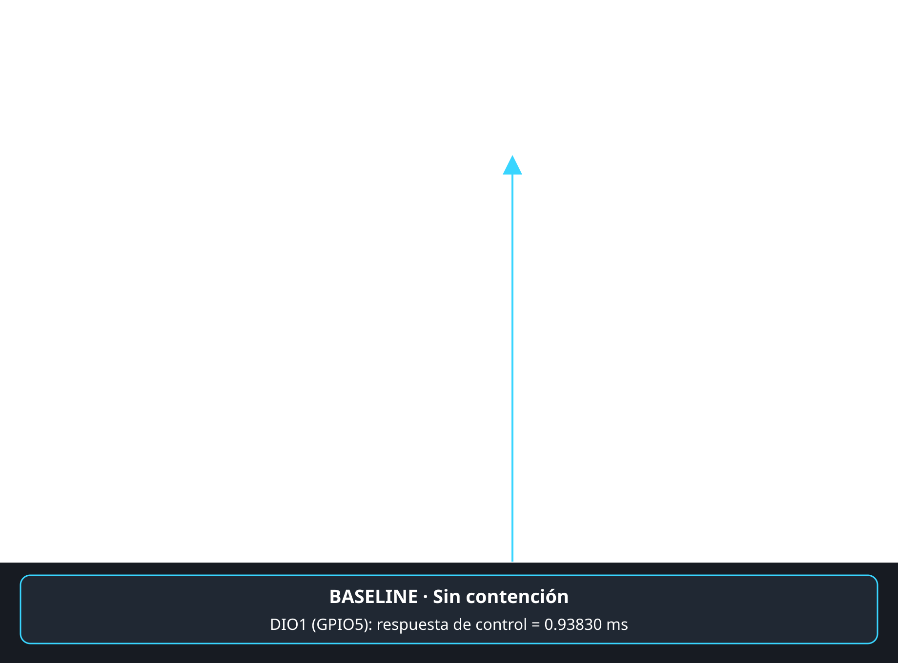

# EV-W06-INV-BASELINE-001 — Control sin contención

- **Firmware:** `firmware/week06_inversion/` en ESP32-S3 DevKitC.
- **Caso:** comando `b`; semáforo libre, sin low ni medium ejecutándose.
- **Analizador:** DIO0=GPIO4 (low), DIO1=GPIO5 (control), DIO2=GPIO6 (medium); 30 M muestras a 10 MHz.
- **Medición:** DIO1 PosWidth = **0.93830 ms**.
- **Observación:** DIO0 y DIO2 permanecen inactivos; el pulso de control registra su respuesta base.

Figura anotada (el PNG original queda sin modificar):

