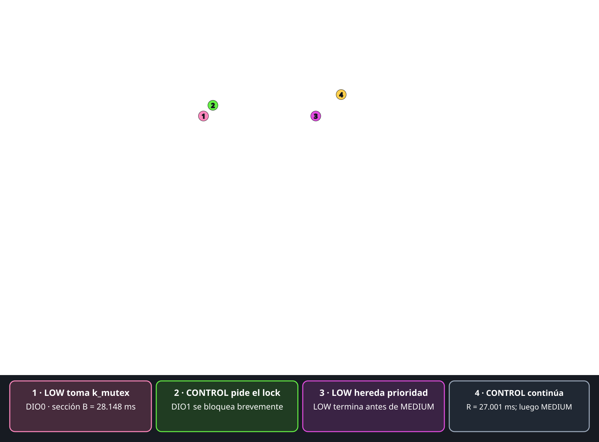

# EV-W06-INV-MUTEX-001 — Priority inheritance

- **Firmware:** `firmware/week06_inversion/`, comando `m` (lock `k_mutex`).
- **Prioridades:** control 2 (alta), medium 4, low 7 (baja).
- **Analizador:** DIO0=GPIO4 (low), DIO1=GPIO5 (control), DIO2=GPIO6 (medium); 30 M muestras a 10 MHz, 10 ms/div.

| Señal | Medición PosWidth |
|---|---:|
| DIO1 — respuesta de control | **27.001 ms** |
| DIO0 — sección crítica de low (B) | **28.148 ms** |
| DIO2 — trabajo de medium | **23.442 ms** |

Figura anotada (el PNG original queda sin modificar):

Con el mutex, low hereda temporalmente la prioridad de control y completa su
sección crítica antes de que medium ejecute. Control responde en 27.001 ms,
frente a 50.466 ms con semáforo y 0.93830 ms sin contención.
